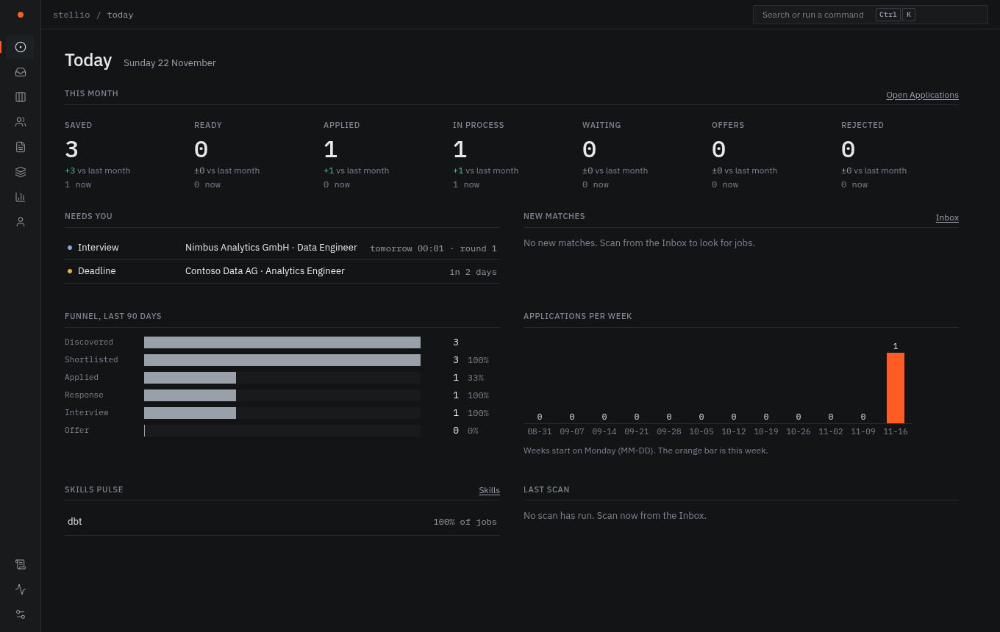
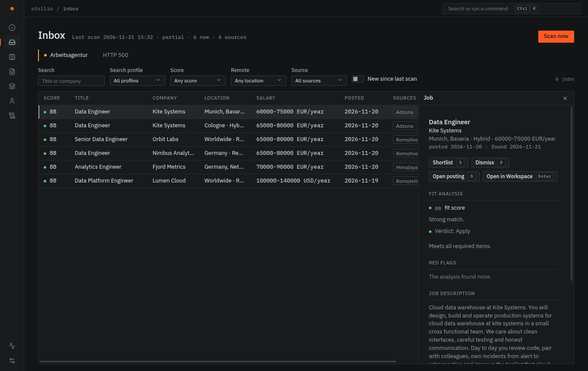
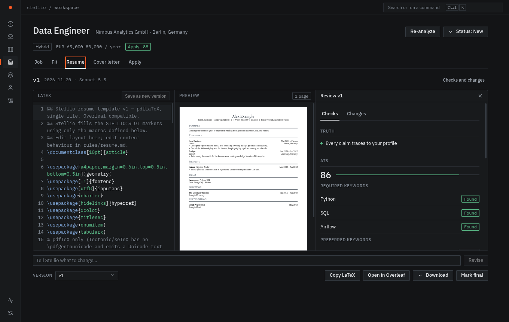
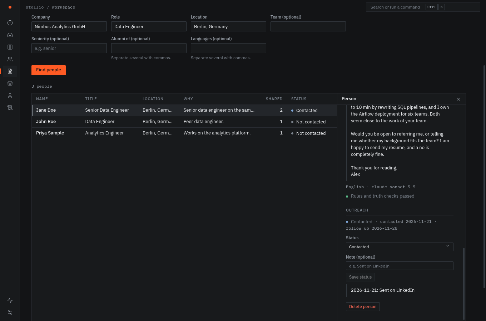
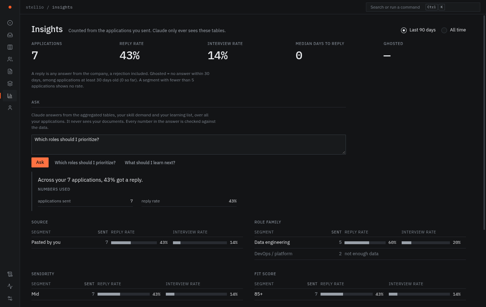

# Stellio

**A local-first desktop career agent for Linux.** Stellio finds jobs every day, tells you honestly how well you fit each one, and writes a tailored LaTeX resume and cover letter that follow rules you control. It checks every skill and claim on the page against your own profile, and it tracks every application in one dashboard.

Everything runs on your machine. Your profile, rules and applications are plain files in a folder you own, versioned with git. The AI work goes through your own [Claude Code](https://docs.anthropic.com/en/docs/claude-code) login, so there is no Stellio account and no Stellio server.



## What it does

- **Finds jobs daily.** Stellio pulls from several boards:
  - Arbeitnow, Bundesagentur für Arbeit, Remotive, RemoteOK and Himalayas
  - Adzuna, if you add a key
  - a watchlist of company career pages on Greenhouse, Lever, Ashby, SmartRecruiters or Workable
  - optionally, a web-search agent

  Jobs are deduplicated across sources, filtered by your hard rules and ranked by fit. The scan can run when the app is closed, through a systemd user timer.
- **Explains fit.** Paste a link or the job text. You get a score with the reasons behind it, matched skills (each linked to the experience that proves it), missing skills, red flags and a verdict.
- **Writes truthful, tailored resumes.** The model chooses and words the content. Code fills in your employers, titles and dates straight from your profile, then renders Overleaf-compatible LaTeX. Every claim is checked before you see it, and invented numbers, skills or employers are blocked. Checks for ATS keywords and for your own rules (page limit, bullet length, banned words) run on every version.
- **Cover letters** go through the same pipeline and the same truth check.
- **Audits skills.** For every skill on a resume, Stellio says whether to keep it, remove it or learn it, or asks whether you have it. Your profile only changes after you confirm a diff.
- **Tracks applications.** A board, a table and a timeline, follow-up reminders and interview rounds. When you mark a job applied, the exact files you sent are frozen into their own folder.
- **Finds referrals.** Stellio finds people at the target company from public sources and drafts a short connection note and message that follow your rules. You send them yourself.
- **Learns from your results.** Response rates by source, role and fit band, a learning roadmap ranked by how often your target jobs ask for a skill, and "Ask" questions answered from your own numbers.

| | |
|---|---|
|  |  |
|  |  |

## Your rules, as files

Resume rules, cover letter rules, the skills policy, referral message rules and the LaTeX templates are plain files in `~/Stellio/rules` and `~/Stellio/templates`. Edit them in the app, with live checks, history and reset to default, or in any editor. Stellio reads them again every time it drafts something.

## Requirements

- Linux x86_64 (built and tested on Debian-based distributions)
- [Claude Code](https://docs.anthropic.com/en/docs/claude-code) installed and logged in (`claude` on your `PATH`)
- `git`, for history and undo of your profile and rules (Stellio still works without it)
- `bubblewrap` (`bwrap`), so LaTeX compiles can run in a sandbox: `sudo apt install bubblewrap`
- A LaTeX engine is optional. Stellio can download and verify [Tectonic](https://tectonic-typesetting.github.io/) for the local PDF preview, and every document also opens in Overleaf.

## Install

Build the AppImage and `.deb` from source (prebuilt downloads will appear under Releases):

```bash
git clone https://github.com/PraneethReddy-github/stellio.git
cd stellio
npm ci
npm run dist          # → release/Stellio-<version>-x86_64.AppImage and .deb
```

On first start Stellio creates `~/Stellio`, which holds your profile, rules, templates and applications, and shows a setup checklist on the Today screen. The [user guide](docs/USER-GUIDE.md) walks through everything.

## Privacy

- No telemetry, no account, no server. The only network traffic is to the job sources you enable, the job links you paste, Overleaf (only when you click "Open in Overleaf"), a daily check of GitHub for a new release (switch it off in Settings) and your Claude Code CLI.
- Job pages and web content are treated as untrusted. Fetching is guarded against private-network addresses, and pages never reach the interface as HTML.
- API keys are encrypted with your system keyring.
- Referrals use public sources only. Stellio never guesses email addresses, never uses people-search or data-broker sites, and never sends a message for you. You can delete people at any time, and people you never contacted are removed automatically.

## Development

```bash
npm ci
npm run dev           # app with hot reload
npm run check         # typecheck, lint, format, unit and integration tests
npm run e2e           # builds, then runs the Playwright end-to-end suite
npm run perf          # performance budget on 5,000 seeded jobs
```

Tests that compile LaTeX need a Tectonic binary: set `STELLIO_TECTONIC_BIN=/path/to/tectonic` (they are skipped otherwise).

Stack: Electron, React 19, TypeScript (strict), SQLite (better-sqlite3 + Drizzle), CodeMirror 6, pdf.js, zod at every boundary. The renderer is sandboxed and served from a custom `app://` protocol with a strict Content-Security-Policy. LaTeX compiles run in a bubblewrap sandbox with no network.

```
src/main        Electron main process: services, database, AI runner, IPC
src/preload     the bridge the interface uses (typed, validated)
src/renderer    the interface
src/shared      pure logic shared by both sides (profile format, checks, schemas)
prompts         versioned AI prompts and their JSON schemas
seed            default profile, rules and templates copied on first run
tests           unit, integration and end-to-end tests
```

## License

All rights reserved. No license has been chosen yet.
